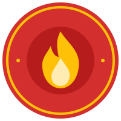
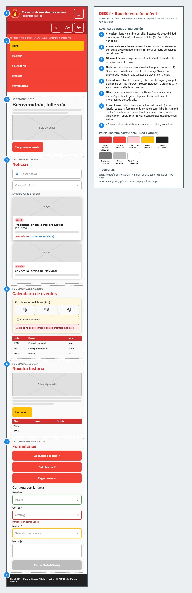
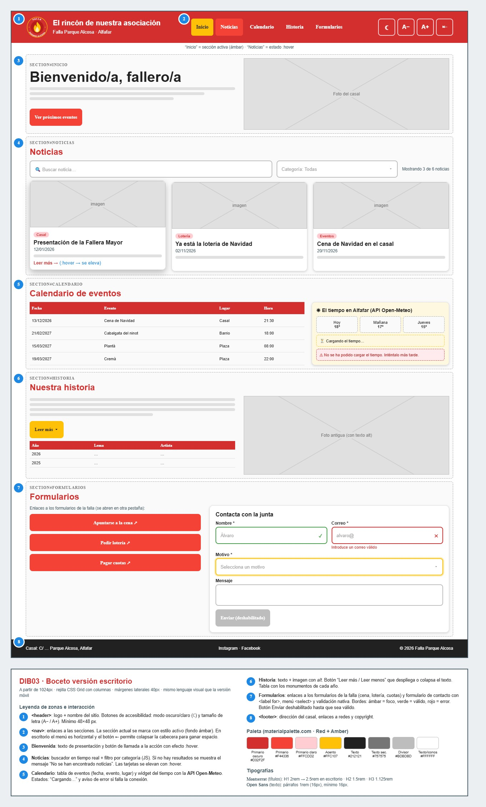

<p align="center">
  
</p>

<h1 align="center">El rincón de nuestra asociación</h1>

<p align="center">Portal interno para los socios y socias de la <strong>Falla Parque Alcosa</strong> (Alfafar, Valencia)</p>

---

## Índice

1. [Descripción del proyecto](#descripción-del-proyecto)
2. [Tabla de planificación](#tabla-de-planificación)
3. [Paleta de colores y tipografías](#paleta-de-colores-y-tipografías)
4. [API externa](#api-externa)
5. [Bocetos del diseño](#bocetos-del-diseño)
6. [Estructura del proyecto](#estructura-del-proyecto)
7. [Funcionamiento de la web](#funcionamiento-de-la-web)
8. [Tecnologías utilizadas](#tecnologías-utilizadas)
9. [Declaración Transparente de IA](#declaración-transparente-de-ia)

---

## Descripción del proyecto

**El rincón de nuestra asociación** es una aplicación web pensada como punto de encuentro digital para los socios de la Falla Parque Alcosa, una asociación cultural fallera del barrio de Parque Alcosa en Alfafar.

Desde el portal los falleros y falleras pueden:

- Leer las **noticias** de la falla y buscarlas o filtrarlas por categoría.
- Consultar el **calendario de eventos** (cenas, cabalgata, plantà, cremà...) junto con la previsión del tiempo.
- Conocer la **historia** de la comisión y los monumentos de otros años.
- Acceder a los **formularios** de la falla (cena, lotería, cuotas) y contactar con la junta.

El proyecto está hecho únicamente con **HTML, CSS y JavaScript Vanilla**, sin librerías, frameworks ni CMS.

---

## Tabla de planificación

| Requisitos | Respuesta |
|---|---|
| **Temática** | Portal web interno de una asociación cultural (falla valenciana) con noticias, calendario de eventos, historia de la falla y enlaces a formularios. |
| **Objetivo** | Centralizar en un solo sitio toda la información de la falla para los socios: consultar y buscar noticias en tiempo real filtrando por categoría, ver los próximos eventos con la previsión del tiempo, conocer la historia de la comisión y acceder rápidamente a los formularios (inscripción a cenas, lotería, cuotas) o contactar con la junta. |
| **Target** | Socios y socias de la Falla Parque Alcosa y sus familias (falleros/as de todas las edades, principalmente de 16 a 65 años) interesados en la vida de la falla y las tradiciones valencianas. |
| **Alcance** | Local (barrio de Parque Alcosa, Alfafar – Valencia). |
| **Nombre del sitio** | El rincón de nuestra asociación |
| **Logo del sitio** | [`assets/logo.svg`](assets/logo.svg) |
| **Paleta de colores** | Primario **Red** `#F44336` (oscuro `#D32F2F`, claro `#FFCDD2`) · Secundario/acento **Amber** `#FFC107` · Texto principal `#212121` · Texto secundario `#757575` · Divisor `#BDBDBD` · Texto sobre primario `#FFFFFF` |
| **Nombre y URL API externa** | **Open-Meteo** (API del tiempo, gratuita y sin clave) · `https://api.open-meteo.com/v1/forecast` |
| **Tipografía principal** | **Montserrat** (Google Fonts) – H1: 32px (2rem) en móvil y 40px (2.5rem) en escritorio, H2: 24px (1.5rem), H3: 18px (1.125rem) |
| **Tipografía secundaria** | **Open Sans** (Google Fonts) – párrafos 16px (1rem) |
| **Repositorio GitHub** | https://github.com/alvarorodriguez-lasalle/el-rincon-de-nuestra-asociacion |
| **Despliegue Vercel** | https://el-rincon-de-nuestra-asociacion.vercel.app |

---

## Paleta de colores y tipografías

La paleta se ha sacado de [Material Palette](https://www.materialpalette.com/) combinando **Red** y **Amber**. Se han elegido estos colores porque son los colores del fuego y de la fiesta de las Fallas.

| Uso | Hex |
|---|---|
| Primario oscuro | `#D32F2F` |
| Primario | `#F44336` |
| Primario claro | `#FFCDD2` |
| Acento | `#FFC107` |
| Texto principal | `#212121` |
| Texto secundario | `#757575` |
| Divisor | `#BDBDBD` |

**Tipografías:**

- **Montserrat** para títulos y encabezados (H1 2rem / 2.5rem, H2 1.5rem, H3 1.125rem).
- **Open Sans** para el texto de párrafos (1rem = 16px como mínimo).

---

## API externa

La web usa la API **Open-Meteo** para mostrar la previsión del tiempo en Alfafar dentro del calendario de eventos. Como muchos actos de la falla son en la calle (cabalgata, plantà, mascletàs, cremà...), a los socios les viene bien saber si va a llover o qué temperatura va a hacer.

- **Nombre:** Open-Meteo – Weather Forecast API
- **Endpoint:** `https://api.open-meteo.com/v1/forecast`
- **Petición que se usará:**

```
https://api.open-meteo.com/v1/forecast?latitude=39.42&longitude=-0.38&daily=weather_code,temperature_2m_max,temperature_2m_min,precipitation_probability_max&timezone=Europe%2FMadrid&forecast_days=3
```

Es gratuita, no necesita registro ni clave (API key) y devuelve los datos en JSON. La llamada se hará con `fetch()` y `async/await` dentro de un `try...catch`, mostrando un mensaje de "Cargando..." mientras responde y un aviso si hay algún error.

---

## Bocetos del diseño

Antes de programar se han hecho los bocetos de la web para móvil (Mobile-First) y para escritorio. En ellos se marcan las zonas semánticas (header, nav, main con sus secciones y footer) y las zonas de interacción y feedback (botones, buscador, formulario con validación, estados de la API...).

### Versión móvil



### Versión escritorio



---

## Estructura del proyecto

```
/
├── index.html          -- Documento HTML principal
├── README.md           -- Documentación del proyecto
├── css/
│   └── styles.css      -- Hoja de estilos externa
├── js/
│   └── main.js         -- Script de JavaScript
└── assets/
    ├── logo.svg            -- Logo de la falla
    ├── boceto-mobile.jpg   -- Boceto versión móvil
    └── boceto-desktop.jpg  -- Boceto versión escritorio
```

---

## Funcionamiento de la web

> Este apartado se irá completando con capturas de pantalla a medida que se desarrollen las secciones de la web.

---

## Tecnologías utilizadas

- HTML5
- CSS3 (variables, Flexbox y Grid)
- JavaScript Vanilla
- Git y GitHub
- Vercel (despliegue)

---

## Declaración Transparente de IA

> Este apartado se completará al finalizar el proyecto.

---

Proyecto realizado para el módulo **Lenguajes de Marcas** – ASIR 2.
